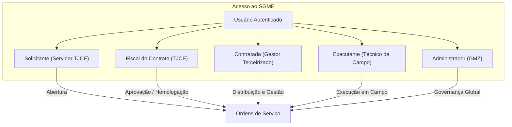
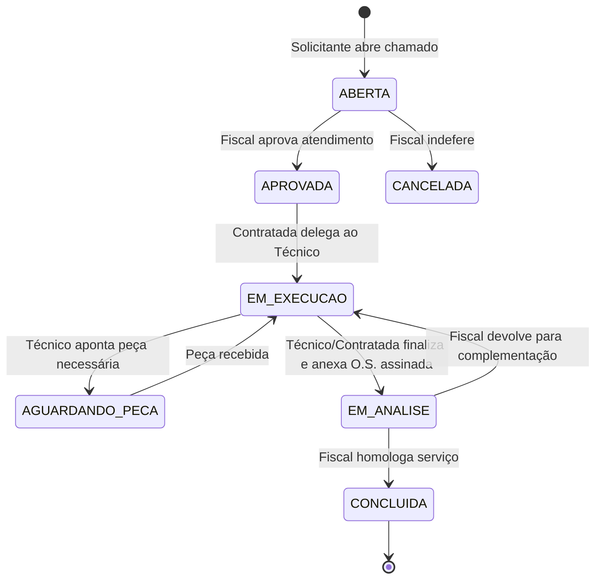
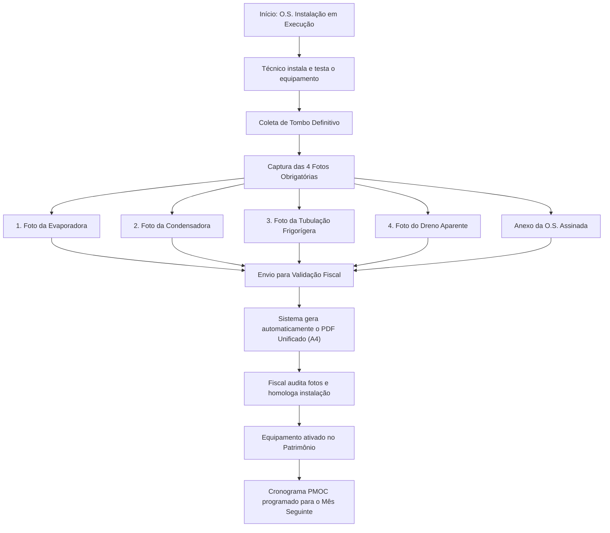
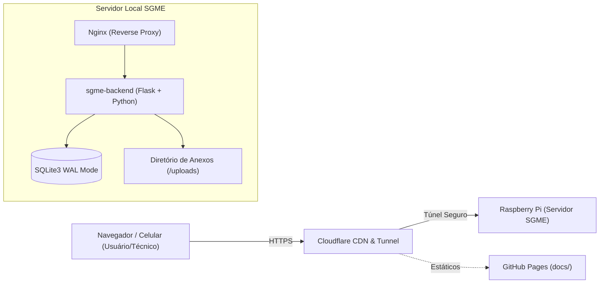

# Manual do Usuário e Operação do Sistema SGME
**Sistema de Gerenciamento de Manutenção e Equipamentos de Climatização**  
**Tribunal de Justiça do Estado do Ceará (TJCE) — Gerência de Manutenção e Zeladoria (GMZ)**

---

## 1. Apresentação e Objetivos

O **SGME** é a plataforma corporativa oficial para governança, controle patrimonial, tramitação de ordens de serviço corretivas e planejamento de manutenções preventivas (**PMOC**) do parque de climatização do Poder Judiciário do Estado do Ceará.

O sistema atende integralmente à **Lei Federal nº 13.589/2018**, à **Portaria MS nº 3.523/1998** e aos padrões de conformidade técnica e fiscalização contratual do TJCE.

### Principais Benefícios:
- **Rastreabilidade Ponta a Ponta**: histórico auditável de cada intervenção mecânica e elétrica.
- **Relatório Fotográfico Automatizado**: unificação digital da folha assinada e fotos em grade A4 para comprovação de instalações e substituições.
- **PMOC Inteligente**: matriz de janela móvel de 25 meses com balanceamento automático de cargas e regras especiais para novos equipamentos.
- **Trava de Custódia Fiscal**: estrita governança contratual impedindo alterações indevidas em serviços já homologados ou em auditoria.
- **Mobile First**: telas otimizadas para uso em smartphones pelos técnicos de campo sem necessidade de download em lojas de aplicativo.

---

## 2. Perfis de Acesso e Matriz de Permissões (RBAC)

O SGME adota controle de acesso baseado em papéis rigorosamente segmentados:



| Funcionalidade | Solicitante | Executante | Contratada | Fiscal | Administrador |
| :--- | :---: | :---: | :---: | :---: | :---: |
| Abrir Chamado Corretivo | ✅ | ❌ | ❌ | ✅ | ✅ |
| Visualizar Fila de Atendimento | Próprios | Designados | Do Contrato | Do Contrato | Global |
| Delegar Técnico Executante | ❌ | ❌ | ✅ | ✅ | ✅ |
| Apontar Falta de Peça | ❌ | ✅ | ✅ | ❌ | ✅ |
| Finalizar Serviço (Anexar O.S.) | ❌ | ✅ | ✅ | ❌ | ✅ |
| Anexar Fotos Obrigatórias de Instalação | ❌ | ✅ | ✅ | ❌ | ✅ |
| Homologar Conclusão de Serviço | ❌ | ❌ | ❌ | ✅ | ✅ |
| Devolver para Complementação | ❌ | ❌ | ❌ | ✅ | ✅ |
| Gerar/Visualizar Relatório Fotográfico | ✅ | ✅ | ✅ | ✅ | ✅ |
| Executar Checklist PMOC em Campo | ❌ | ✅ | ❌ | ❌ | ✅ |
| Validar Matriz de Preventivas (PMOC) | ❌ | ❌ | ✅ | ✅ | ✅ |
| Gestão de Contratos e Usuários | ❌ | ❌ | ❌ | ❌ | ✅ |

---

## 3. Módulo de Ordens de Serviço Corretivas

### 3.1 Ciclo de Vida da O.S. Corretiva



### 3.2 Passo a Passo por Perfil:

#### A. Solicitante (Abertura de Chamado):
1. Acesse o sistema e selecione **Nova Solicitação**.
2. Escolha a **Comarca**, o **Prédio** e a **Sala**.
3. Localize o equipamento pelo número de **Tombo** ou descrição (se não possuir tombo, selecione a opção `S/T`).
4. Descreva detalhadamente a falha (ex.: *"Equipamento não gela e apresenta gotejamento na unidade interna"*).
5. Clique em **Abrir O.S.** e anote o número gerado.

#### B. Contratada (Triagem e Gestão):
1. No painel, visualize os chamados em status **APROVADA**.
2. Clique em **Tratar O.S.**, selecione o **Técnico Executante** responsável e confirme. A O.S. passa para **EM EXECUÇÃO**.
3. Se o técnico indicar necessidade de peças, acompanhe a fila em **AGUARDANDO PEÇA** e remeta o chamado de volta para execução tão logo o insumo chegue.

#### C. Executante (Atendimento em Campo):
1. O técnico visualiza em seu celular apenas os chamados designados para ele.
2. Ao iniciar o conserto, clica em **Tratar O.S.**.
3. Concluído o serviço físico, colhe a assinatura física ou digital do responsável local na folha de O.S.
4. Clica em **Tirar Foto / Anexar O.S. Concluída**, envia a imagem/PDF e confirma o envio para **Validação Fiscal**.

#### D. Fiscal (Homologação e Atesto):
1. O fiscal filtra as ordens em **EM ANÁLISE**.
2. Clica no botão **📄 Folha assinada** para verificar o documento anexado.
3. Se o serviço estiver em conformidade, clica em **Homologar Serviço** (status vai para **CONCLUÍDA**).
4. Caso haja inconformidade técnica ou falta de assinatura, clica em **Devolver para Complementação** inserindo a justificativa obrigatória.

---

## 4. Módulo de O.S. de Instalação e Substituição

Instalações e substituições de aparelhos contam com exigências técnicas especiais para formalização patrimonial e fiscal.



### 4.1 Documentos e Fotos Obrigatórias
Para tramitar uma O.S. de instalação para validação do Fiscal, o sistema exige:
1. **Tombo Patrimonial**: Código numérico patrimonial do TJCE (o sistema rejeita tombo vazio ou `S/T`).
2. **Folha de O.S. Concluída/Assinada**: Arquivo em PDF ou imagem com assinaturas.
3. **4 Fotos de Campo**:
   - `Foto 1`: Unidade Evaporadora instalada no ambiente.
   - `Foto 2`: Unidade Condensadora instalada externamente.
   - `Foto 3`: Tubulação Frigorígera aparente (isolamento térmico e fixação).
   - `Foto 4`: Dreno Aparente (percurso e escoamento adequado).

### 4.2 Relatório Fotográfico Unificado (Página 1 + Página 2)
O sistema processa automaticamente todos os arquivos enviados e gera um único PDF oficial em formato **A4**:
- **Página 1**: Folha de O.S. concluída e assinada (renderizada e ajustada proporcionalmente ao tamanho A4).
- **Página 2**: Relatório Fotográfico Oficial contendo:
  - Cabeçalho institucional do Poder Judiciário do Ceará / GMZ.
  - Tabela com metadados do serviço: Número da O.S., Data de Conclusão, Contrato, Comarca, Prédio, Sala, Marca/Capacidade e Tombo destacado.
  - **Grade 2×2 padronizada** com as 4 fotos em alta resolução ajustadas proporcionalmente com legendas em fundo azul e texto em negrito:
    - `1. UNIDADE EVAPORADORA`
    - `2. UNIDADE CONDENSADORA`
    - `3. TUBULAÇÃO FRIGORÍFERA APARENTE`
    - `4. DRENO APARENTE`

> [!NOTE]
> O botão onde anteriormente se visualizava apenas a folha de O.S. agora passa a se chamar **📄 O.S. Assinada & Relatório Fotográfico (PDF)**, permitindo download e visualização imediata do documento completo.

---

## 5. Módulo PMOC (Manutenção Preventiva, Operação e Controle)

O módulo PMOC foi desenvolvido para automatizar o cumprimento da **Lei 13.589/2018**, eliminando controles manuais em planilhas e garantindo conformidade nos contratos terceirizados.

### 5.1 Ciclos de Periodicidade
As rotinas preventivas são divididas em 4 níveis de abrangência técnica:

| Ciclo | Sigla | Cor no Sistema | Periodicidade | Descrição dos Serviços |
| :---: | :---: | :---: | :---: | :--- |
| **Mensal** | **M** | Azul | Mensal | Limpeza e higienização de filtros de ar, verificação de drenos, eliminação de odores, conferência visual de vazamentos e medições operacionais básicas. |
| **Trimestral** | **T** | Verde | Trimestral | Todos os itens mensais + higienização de bandejas de condensado, conferência e aperto de conexões elétricas, inspeção de ventiladores e verificação de ruídos/vibrações anormais. |
| **Semestral** | **S** | Laranja | Semestral | Todos os itens trimestrais + lavagem química ou mecânica profunda de serpentinas (evaporadora e condensadora), conferência de capacitores e teste de isolamento. |
| **Anual** | **A** | Roxo | Anual | Todos os itens semestrais + revisão completa do circuito frigorígeno, reaperto geral de suportes e ancoragens estruturais, alinhamento de motores e teste de rendimento térmico. |

### 5.2 Regra Oficial de Manutenção Anual (8M + 2T + 1S + 1A)
Ao longo de 12 meses, cada equipamento ativo cumpre rigorosamente:
$$\text{Total Anual} = 8\times \text{Mensal (M)} + 2\times \text{Trimestral (T)} + 1\times \text{Semestral (S)} + 1\times \text{Anual (A)} = 12 \text{ intervenções}$$

### 5.3 Regra de Negócio para Equipamentos Recém-Instalados

> [!IMPORTANT]
> **Norma Operacional TJCE/SGME**:
> 1. **No mês em que o equipamento é instalado**, ele **não entra** no cronograma de preventivas (exibe o traço **`—`** na matriz), pois já foi testado, comissionado e entregue revisado pela equipe técnica.
> 2. O cronograma de preventivas inicia-se **somente no mês seguinte à instalação**.
> 3. As **duas primeiras manutenções preventivas subsequentes** são obrigatoriamente do tipo **MENSAL (`M`)**, assegurando monitoramento inicial sem sobrecarregar com revisões pesadas desnecessárias.

#### Linha do Tempo da Cadência Pós-Instalação:
Considerando um equipamento instalado no mês **10/2026**:

| Mês / Ano | Mês Relativo | Periodicidade | Situação Operacional |
| :---: | :---: | :---: | :--- |
| **10/2026** | $\Delta = 0$ | **`—`** | **Mês de Instalação**: Não entra no cronograma preventivo. |
| **11/2026** | $\Delta = 1$ | **`M`** | **1ª Preventiva**: Obrigatoriamente Mensal. |
| **12/2026** | $\Delta = 2$ | **`M`** | **2ª Preventiva**: Obrigatoriamente Mensal. |
| **01/2027** | $\Delta = 3$ | **`T`** | **1º Trimestral**: Aos 3 meses de operação contínua. |
| **02/2027** | $\Delta = 4$ | **`M`** | Mensal regular. |
| **03/2027** | $\Delta = 5$ | **`M`** | Mensal regular. |
| **04/2027** | $\Delta = 6$ | **`S`** | **Semestral**: Aos 6 meses de operação contínua. |
| **05/2027** | $\Delta = 7$ | **`M`** | Mensal regular. |
| **06/2027** | $\Delta = 8$ | **`M`** | Mensal regular. |
| **07/2027** | $\Delta = 9$ | **`T`** | **2º Trimestral**: Aos 9 meses de operação contínua. |
| **08/2027** | $\Delta = 10$ | **`M`** | Mensal regular. |
| **09/2027** | $\Delta = 11$ | **`M`** | Mensal regular. |
| **10/2027** | $\Delta = 12$ | **`A`** | **Anual**: Completando 1 ano completo de operação. |

### 5.4 Matriz Visual de Janela Móvel (25 Meses)
A matriz do PMOC apresenta uma visão deslizante dinâmica com 25 colunas mensais:
- **12 Meses Anteriores (Histórico)**: Colunas com fundo acinzentado apresentando o que já foi executado no passado.
- **Coluna Central Azul (`ATUAL`)**: Destaque para o mês de competência vigente.
- **12 Meses Subsequentes (A Executar)**: Planejamento futuro dos próximos 12 meses.

**Significado dos Selos Visuais:**
- Selo com borda tracejada: Serviço **Planejado** (aguardando mês de execução).
- Selo com borda sólida e ícone `⏳`: Ordem **Gerada / Em Execução** no mês corrente.
- Selo com borda sólida e ícone `✓`: Ordem **Concluída e Homologada** pelo Fiscal.
- Selo com borda vermelha e ícone `❌`: Ordem **Reprovada** pelo Fiscal.
- Traço cinza (`—`): Sem manutenção prevista (ex.: mês da instalação).

### 5.5 Execução e Medições Técnicas de Campo
Na execução da preventiva pelo celular, o técnico deve registrar:
1. **Medições Elétricas e Térmicas Obrigatórias**:
   - Tensão Elétrica Medida ($V$)
   - Corrente Elétrica de Operação ($A$)
   - Temperatura de Insuflamento ($^\circ C$)
   - Temperatura de Retorno do Ambiente ($^\circ C$)
2. **Checklist Conforme / Não Conforme**: Marcação dos itens normativos de filtro, serpentina, dreno e elétrica.
3. **Anexo Comprobatório**: Upload da folha de preventiva física assinada pelo usuário do setor.

---

## 6. Gestão Patrimonial e Inventário de Equipamentos

O módulo de equipamentos centraliza o cadastro de todo o parque térmico das comarcas:
- **Tombamento**: Número patrimonial oficial do TJCE.
- **Localização Estrita**: Comarca $\rightarrow$ Prédio $\rightarrow$ Sala.
- **Dados Técnicos**: Marca, Capacidade em BTUs/TR, Tipo de Equipamento (Hi-Wall, Cassete, Piso-Teto, Multi-Split, Chiller, Fancoil, VRF, etc.).
- **Vínculo Contratual**: Associação a um contrato ativo da comarca.
- **Histórico Integrado**: Botão que abre a linha do tempo completa do equipamento, exibindo todas as ordens corretivas e preventivas executadas ao longo de sua vida útil.

---

## 7. Arquitetura Técnica e Guia de Deploy



### 7.1 Componentes da Arquitetura
- **Frontend**: Single Page Application (SPA) em HTML5, CSS moderno e Vanilla JavaScript, com zero dependências de build (sem Node.js, Webpack ou frameworks externos).
- **Backend**: Python 3.11 com Flask, ReportLab (emissão de PDFs oficiais), PyPDF (fusão e manipulação de páginas), Pillow (otimização e redimensionamento de imagens) e PyJWT (autenticação segura sem cookies de sessão).
- **Banco de Dados**: SQLite3 em modo **WAL (Write-Ahead Logging)** garantindo alta concorrência e integridade transacional sem consumo excessivo de memória RAM (< 100 MB).
- **Conectividade**: Cloudflare Tunnel automatizado com script de sincronização de URL pública.

### 7.2 Procedimento Padrão de Atualização e Deploy (SSH & WinSCP)
Para aplicar novas versões do sistema sem intervenção manual complexa:

1. **Localize os arquivos na sua máquina de desenvolvimento**:
   - `sgme_vX.X.tar` (pacote contendo código fonte e estáticos)
   - `sgme_vX.X.sh` (script de instalação e deploy automático)
2. **Transfira para a Raspberry Pi via WinSCP**:
   - Conecte no IP da Raspberry Pi com o usuário `daniel`.
   - Copie ambos os arquivos para a pasta `/home/daniel/sgme`.
3. **Execute via terminal SSH**:
   ```bash
   cd /home/daniel/sgme
   chmod +x sgme_vX.X.sh
   ./sgme_vX.X.sh
   ```
4. **O script executará automaticamente**:
   - Extração segura sobrescrevendo arquivos anteriores.
   - Aplicação de migrações no banco de dados SQLite sem perda de dados existentes.
   - Commit e envio das alterações para o GitHub Pages.
   - Limpeza total de arquivos `.tar`, temporários e caches `__pycache__`.
   - Reinício dos serviços do backend Flask, Nginx e Túnel Cloudflare.
   - Registro de histórico da versão em `VERSAO.txt`.

---

## 8. Glossário de Termos e Perguntas Frequentes (FAQ)

### Perguntas Frequentes:

**1. Por que um equipamento recém-instalado não aparece no PMOC do mês atual?**  
Porque ele acabou de ser montado, higienizado e comissionado. A legislação e as boas práticas de engenharia determinam que a rotina preventiva regular inicie no mês seguinte à instalação, iniciando com manutenções mensais (`M`).

**2. O que acontece quando um ar-condicionado é substituído?**  
Ao homologar a O.S. de substituição, o sistema desativa automaticamente o equipamento antigo no banco (marcando status como `SUBSTITUÍDO`) e cadastra o novo aparelho no mesmo local com o novo número de tombo, iniciando sua cadência preventiva.

**3. Por que o técnico não consegue alterar o chamado após enviar a folha de O.S.?**  
Entra em vigor a **Trava de Custódia Fiscal**. A partir do momento em que a O.S. vai para validação fiscal, ela fica congelada para garantir a idoneidade do documento até manifestação oficial do Fiscal do TJCE. Se houver erro, o Fiscal devolve o chamado com justificativa.

**4. As fotos enviadas pelo celular consomem muita internet do técnico?**  
Não. O SGME conta com motor de compressão client-side no navegador do celular antes do envio, redimensionando as fotos para o tamanho ideal de visualização e laudo sem consumir a franquia de dados do operador.

---
*Manual técnico elaborado para o SGME — TJCE / GMZ.*
